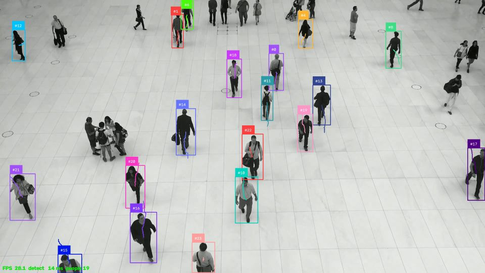
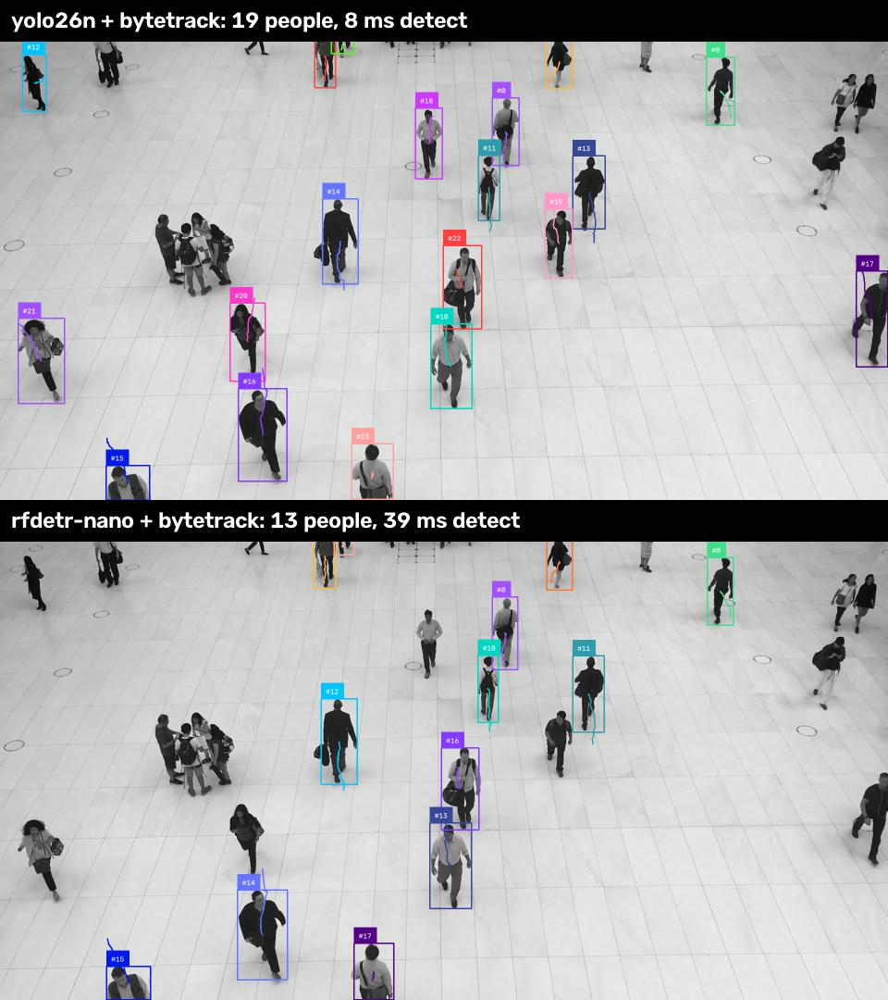

# Progress

What each phase changed, shown as before and after: how the project was used, what it could
do, and what it measured. Measurements and the reasoning behind each decision are in
[NOTES.md](../NOTES.md); the plan and gates are in [PLAN.md](PLAN.md).

All images come from `people-walking.mp4`, a public sample clip from the
[supervision](https://github.com/roboflow/supervision) assets (1920x1080, 25 FPS, about 25
people), on a laptop GTX 1650.

| Phase | Version | Gate | Status |
| --- | --- | --- | --- |
| 0. Webcam baseline | 0.1.0 | One person keeps one ID for 15 s; FPS and failures logged | Passed |
| 1. Pipeline package | 0.2.0 | Swap detector or tracker with one config line | Passed |
| 2. Analytics and event log | 0.3.0 | Counts match a hand count; event log reproduces them | Next |

## Phase 0: webcam baseline (v0.1.0)

**Before.** A scaffold: package folders, CI and a data download script. No code that
detects or tracks anything.

**After.** `scripts/webcam_baseline.py` runs YOLO26n and ByteTrack on a webcam or video
file, draws an ID, a box and a trail per person, and records the result in real time.

| | Result |
| --- | --- |
| Gate test | One person kept the same ID for 76 s (gate: 15 s), through turning, walking away and back, and motion blur |
| Speed | 20.5 FPS on the webcam, capped by the camera (it drops from 30 to 20 FPS in dim light); 20 ms per frame for detection and tracking |
| Failure 1 | A person who leaves the frame for more than about 1 s gets a new ID on return (one person, five IDs over 115 s) |
| Failure 2 | People only partly in view (an arm at the edge, a torso cut off) are missed or split into short tracks |

Fixes made during the phase: the tracker receives real capture times, the recording plays
at real speed when the camera is slower than it claims, labels stay on screen for
close-ups, and each ID has its own colour so ID switches are visible.

## Phase 1: pipeline package (v0.2.0)

**Before.** One script with the model and tracker written into the code. Trying another
detector or tracker meant editing it.

```bash
uv run python scripts/webcam_baseline.py --source clip.mp4
```

**After.** A package with a single command. The detector and tracker are chosen in
[configs/default.yaml](../configs/default.yaml) or with one `--set` on the command line.

```bash
uv run pathsense run --source clip.mp4
uv run pathsense run --source clip.mp4 --set detector.name=rfdetr-nano
uv run pathsense run --source clip.mp4 --set tracker.name=botsort
```

| | Before (Phase 0) | After (Phase 1) |
| --- | --- | --- |
| Detectors | YOLO26n only | YOLO26n, YOLO26s, RF-DETR Nano, RF-DETR Small |
| Trackers | ByteTrack only | ByteTrack, BoT-SORT, OC-SORT |
| Changing a stage | Edit the code | One config line |
| Config mistakes | Not applicable | Stopped with a message listing valid options, before the camera opens |
| Reuse | One script | `Pipeline`, `VideoSource`, `RealTimeVideoWriter`, `Annotator` usable from Python |
| Timing | One combined number | Detection and tracking measured separately |
| Tests | 11 | 57, plus 2 opt in tests with the real models |



*`pathsense run` with the defaults (YOLO26n and ByteTrack). Each person has an ID, a box
and a trail in their own colour; the bottom line shows FPS, detection time and the number
of people tracked.*

### Swapping the detector

Same frame, same tracker, only `detector.name` changed:



Full clip (341 frames), mean per frame:

| Detector | Tracker | FPS | Detection | Tracking |
| --- | --- | --- | --- | --- |
| YOLO26n | ByteTrack | 95.2 | 8.3 ms | 0.7 ms |
| YOLO26n | OC-SORT | 96.1 | 8.1 ms | 0.9 ms |
| YOLO26n | BoT-SORT | 30.2 | 14.4 ms | 17.4 ms |
| YOLO26n | BoT-SORT, camera motion compensation off | 94.0 | 8.2 ms | 1.0 ms |
| RF-DETR Nano | ByteTrack | 24.7 | 38.5 ms | 0.6 ms |
| RF-DETR Nano | OC-SORT | 24.5 | 38.6 ms | 0.8 ms |
| RF-DETR Nano | BoT-SORT | 19.8 | 38.8 ms | 10.2 ms |

### What Phase 1 showed

- **YOLO26n is the default.** It detects 4.6x faster than RF-DETR Nano on this GPU.
  RF-DETR stays available because its Apache 2.0 license suits commercial use.
- **RF-DETR runs in FP32.** Half precision is 4.5x slower on the GTX 1650, which has no
  tensor cores.
- **BoT-SORT needs camera motion compensation turned off for fixed cameras.** It costs
  10 to 17 ms per frame and only helps when the camera moves.
- **The tracker, not the detector, limits how many people are tracked.** The detectors
  find about 23 people per frame (confidence 0.3 or more), but ByteTrack's default
  settings only start a track for boxes above 0.7, so about 14 per frame are tracked. In
  the image above, the group on the left and several walkers at the edges are detected
  but never get an ID. Lowering the start threshold to 0.5 tracks 17.7 per frame, but also
  creates more IDs (39 instead of 32), which may mean more ID switches. Choosing the
  setting needs ground truth, so it is part of the Phase 3 evaluation.

## Open issues carried forward

| Issue | Found in | Planned in |
| --- | --- | --- |
| New ID after leaving the frame for more than about 1 s; none of the three trackers recognises a returning person by appearance | Phase 0 | Phase 3: longer lost track buffer and an appearance based re-identification step |
| Partly visible people at the frame edge missed or split | Phase 0 | Phase 4: fine tuning |
| Detected people not tracked because the track start threshold is high | Phase 1 | Phase 3: tune against MOT17 ground truth |
