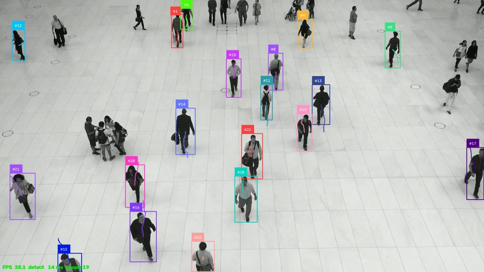
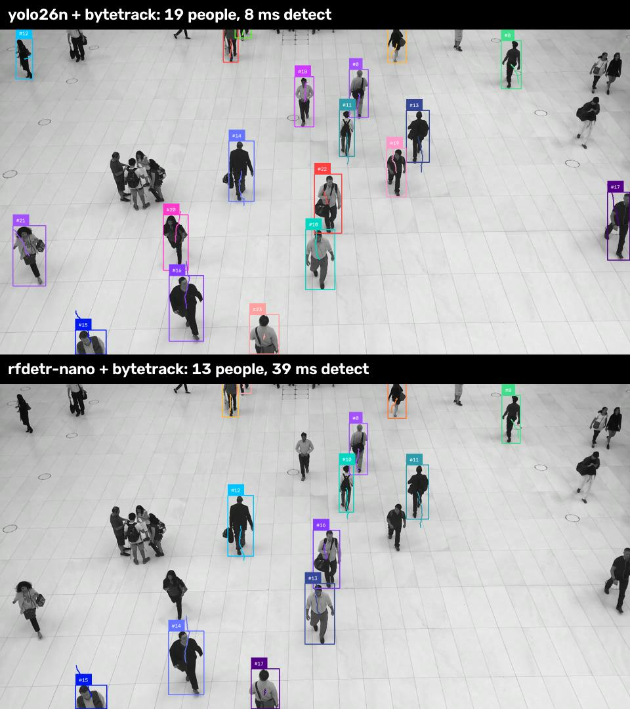
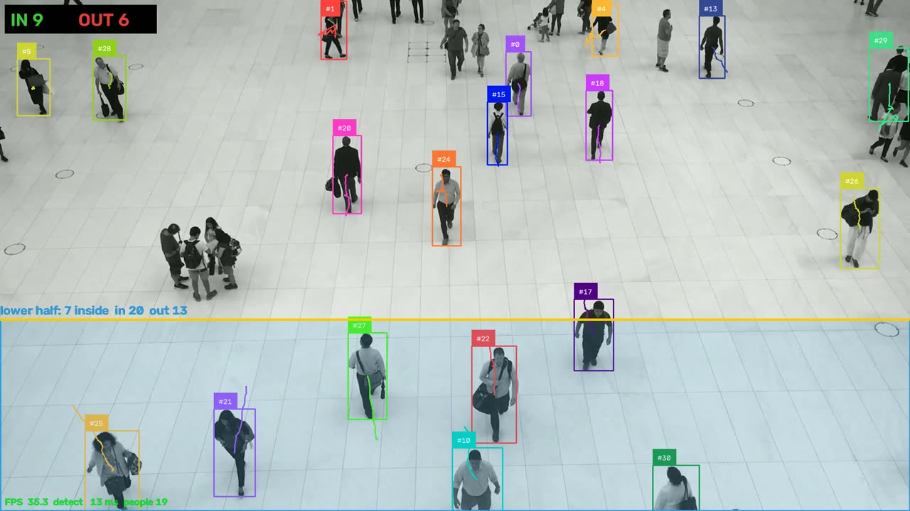
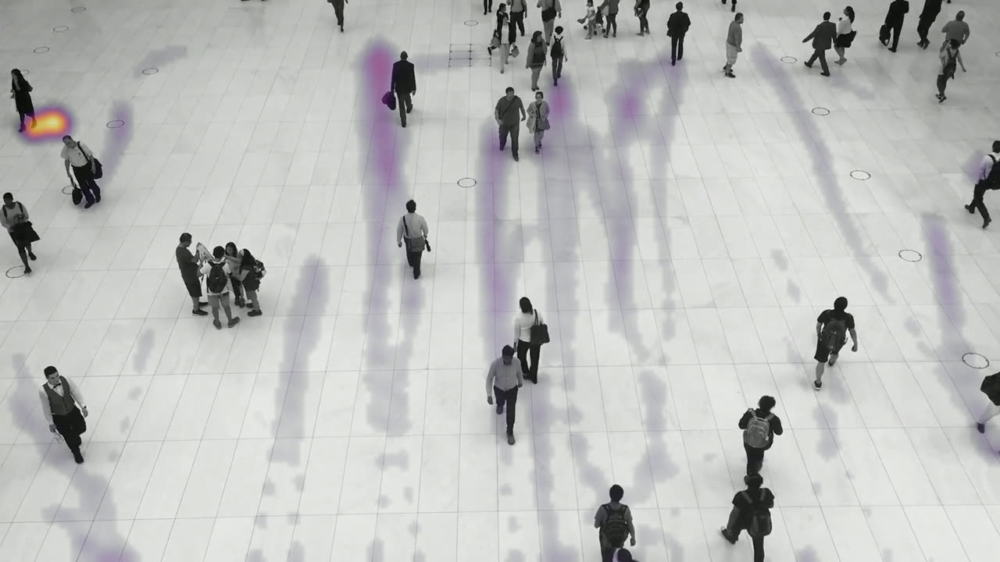
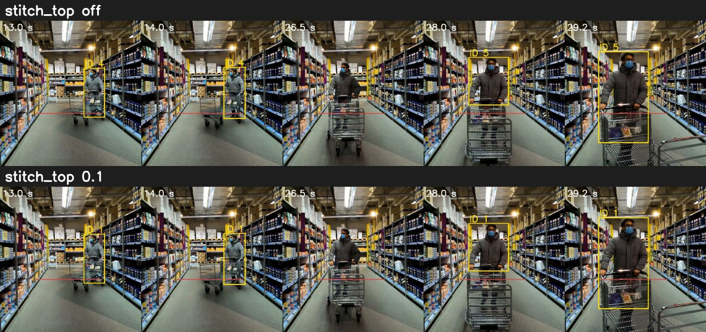

# Progress

What each phase changed, shown as before and after: how the project was used, what it could
do, and what it measured. Measurements and the reasoning behind each decision are in
[NOTES.md](../NOTES.md); the plan and gates are in [PLAN.md](PLAN.md).

All images come from public sample clips from the
[supervision](https://github.com/roboflow/supervision) assets: `people-walking.mp4`
(1920x1080, 25 FPS, about 25 people) and, for Phase 3, `grocery-store.mp4` (4K, 33 s), on a
laptop GTX 1650.

| Phase | Version | Gate | Status |
| --- | --- | --- | --- |
| 0. Webcam baseline | 0.1.0 | One person keeps one ID for 15 s; FPS and failures logged | Passed |
| 1. Pipeline package | 0.2.0 | Swap detector or tracker with one config line | Passed |
| 2. Analytics and event log | 0.3.0 | Counts match a hand count; event log reproduces them | Passed |
| 3. Evaluation and scene tuning | 0.4.0 | Fewer false crossings in a crowd, holding on check scenes; all eleven scenes in a table | Passed |
| 4. Train on Open Images | 0.5.0 | Fine tuned model beats the COCO one on held out data; ONNX runs | Next |

## Phase 0: webcam baseline (v0.1.0)

**Before.** A scaffold: package folders, CI and a data download script. No code that
detects or tracks anything.

**After.** `scripts/webcam_baseline.py` runs YOLO26n and ByteTrack on a webcam or video
file, draws an ID, a box and a trail per person, and records the result in real time.

| | Result |
| --- | --- |
| Gate test | One person kept the same ID for 76 s (gate: 15 s), through turning, walking away and back, and motion blur |
| Speed | 20.5 FPS on the webcam, capped by the camera (it drops from 30 to 20 FPS in dim light); 20 ms per frame for detection and tracking |
| Failure 1 | A person who leaves the frame for more than about 1 s gets a new ID on return (one person, five IDs over 115 s) |
| Failure 2 | People only partly in view (an arm at the edge, a torso cut off) are missed or split into short tracks |

Fixes made during the phase: the tracker receives real capture times, the recording plays
at real speed when the camera is slower than it claims, labels stay on screen for
close-ups, and each ID has its own colour so ID switches are visible.

## Phase 1: pipeline package (v0.2.0)

**Before.** One script with the model and tracker written into the code. Trying another
detector or tracker meant editing it.

```bash
uv run python scripts/webcam_baseline.py --source clip.mp4
```

**After.** A package with a single command. The detector and tracker are chosen in
[configs/default.yaml](../configs/default.yaml) or with one `--set` on the command line.

```bash
uv run pathsense run --source clip.mp4
uv run pathsense run --source clip.mp4 --set detector.name=rfdetr-nano
uv run pathsense run --source clip.mp4 --set tracker.name=botsort
```

| | Before (Phase 0) | After (Phase 1) |
| --- | --- | --- |
| Detectors | YOLO26n only | YOLO26n, YOLO26s, RF-DETR Nano, RF-DETR Small |
| Trackers | ByteTrack only | ByteTrack, BoT-SORT, OC-SORT |
| Changing a stage | Edit the code | One config line |
| Config mistakes | Not applicable | Stopped with a message listing valid options, before the camera opens |
| Reuse | One script | `Pipeline`, `VideoSource`, `RealTimeVideoWriter`, `Annotator` usable from Python |
| Timing | One combined number | Detection and tracking measured separately |
| Tests | 11 | 57, plus 2 opt in tests with the real models |



*`pathsense run` with the defaults (YOLO26n and ByteTrack). Each person has an ID, a box
and a trail in their own colour; the bottom line shows FPS, detection time and the number
of people tracked.*

### Swapping the detector

Same frame, same tracker, only `detector.name` changed:



Full clip (341 frames), mean per frame:

| Detector | Tracker | FPS | Detection | Tracking |
| --- | --- | --- | --- | --- |
| YOLO26n | ByteTrack | 95.2 | 8.3 ms | 0.7 ms |
| YOLO26n | OC-SORT | 96.1 | 8.1 ms | 0.9 ms |
| YOLO26n | BoT-SORT | 30.2 | 14.4 ms | 17.4 ms |
| YOLO26n | BoT-SORT, camera motion compensation off | 94.0 | 8.2 ms | 1.0 ms |
| RF-DETR Nano | ByteTrack | 24.7 | 38.5 ms | 0.6 ms |
| RF-DETR Nano | OC-SORT | 24.5 | 38.6 ms | 0.8 ms |
| RF-DETR Nano | BoT-SORT | 19.8 | 38.8 ms | 10.2 ms |

### What Phase 1 showed

- **YOLO26n is the default.** It detects 4.6x faster than RF-DETR Nano on this GPU.
  RF-DETR stays available because its Apache 2.0 license suits commercial use.
- **RF-DETR runs in FP32.** Half precision is 4.5x slower on the GTX 1650, which has no
  tensor cores.
- **BoT-SORT needs camera motion compensation turned off for fixed cameras.** It costs
  10 to 17 ms per frame and only helps when the camera moves.
- **The tracker, not the detector, limits how many people are tracked.** The detectors
  find about 23 people per frame (confidence 0.3 or more), but ByteTrack's default
  settings only start a track for boxes above 0.7, so about 14 per frame are tracked. In
  the image above, the group on the left and several walkers at the edges are detected
  but never get an ID. Lowering the start threshold to 0.5 tracks 17.7 per frame, but also
  creates more IDs (39 instead of 32), which may mean more ID switches. Choosing the
  setting needs ground truth, so it is part of the Phase 3 evaluation.

## Phase 2: analytics and event log (v0.3.0)

**Before.** People had IDs and trails, but nothing was counted. There was no record of what
happened, and every camera used the same settings.

**After.** Lines, zones, dwell, occupancy and a heatmap, all written to a JSON lines event
log. A scene file holds one camera's lines, zones and detector settings.

```bash
uv run pathsense run --scene configs/scenes/people-walking.yaml --events runs/pw.jsonl --heatmap runs/pw.png
```



*The line across the concourse counts people walking down (IN) and up (OUT); the shaded
lower half is a zone with its own enters, exits and people inside.*

| | Before (Phase 1) | After (Phase 2) |
| --- | --- | --- |
| Counting | None | Lines (also curved, several points), each direction, with a 0.5 s hold against jitter |
| Areas | None | Zones: enter, exit, dwell seconds, people inside now |
| Record | None | Event log: `enter`, `exit`, `zone_enter`, `zone_exit`, `dwell`, each with time, frame and ID |
| Where people stand | Box bottom | Feet from the head when a cart or person hides the legs (per scene) |
| Lost for a moment | New ID | Old ID back within 2 s, from position, motion and size only |
| Per camera settings | None | Scene files: line, zones, input size, tiles, partial box filter |
| Testing | One clip by eye | Four sample clips plus seven MOT scenes scored against hand labelled tracks |
| Tests | 57 | 250 |

### The gate

| Check | Result |
| --- | --- |
| Line against a hand count (people-walking) | 11 IN, 7 OUT; hand count 11, 7 |
| Every event type against hand labelled truth (MOT17-04, night street) | Line 8 IN (truth 8), 4 OUT (5). Zone: 37 enters against 42 visible, dwell 450 s against 448 visible, 13 inside against 13.1 visible |
| Event log reproduces the counts | Yes, on both clips: every count and the total dwell |

MOT frames are not shown here; their license allows evaluation only.



*Person seconds on the floor. The walking paths show as streaks and a person standing at
the top left as a hot spot. The group of four standing on the left gets no heat: the
detector never boxes them as separate people. That is the cluster problem below.*

### What Phase 2 showed

- **Every scene is different.** Far people need input size 1920, a market square seen from
  far above needs tiles, a cart needs the partial box filter, a wide lens needs a curved
  line. Settings belong to the scene, so Phase 3 builds scene tuning.
- **Truth splits the errors.** Scoring against labelled tracks gives three numbers: truth
  (everyone, hidden too), seen (people at least a quarter visible) and ours. On the night
  street ours matches seen; the rest is people hidden behind others, which no camera sees.
- **Crowds swap IDs.** In the MOT20 stadium crowds the main direction is counted well, but
  an ID handed to the neighbour behind crosses back over the line: 28 false crossings the
  wrong way against 4 real ones. This is tracking, not counting logic; net counting per ID
  was tried and only traded it for missed exits.

## Phase 3: evaluation and scene tuning (v0.4.0)

**Before.** Counts were checked against one hand count. Every camera ran `yolo26n` at 640
unless someone wrote a scene file by hand, and when a count was off there was no way to tell
whether the detector, the tracker or a setting was to blame. In crowds, IDs handed to a
neighbour counted people crossing the wrong way.

**After.** Every scene is scored against truth, two studies say which settings matter, and
settings are chosen from data: with truth by `pathsense tune`, without it by
`pathsense run --auto`.

```bash
uv run pathsense tune configs/scenes/people-walking.yaml        # setups ranked against truth
uv run pathsense run --source data/samples/people-walking.mp4 --auto
```



*The last fault found on the sample clips. Behind the cart the shopper's whole body box drops
below the confidence bar and an upper body box takes over (28.0 s). Top: the tracker gives it
a new ID, which crosses the line again as the whole body returns (29.2 s), so one shopper is
counted IN twice. Bottom: `tracker.stitch_top` links the boxes by their top, and the shopper
keeps ID 1 and one count.*

| | Before (Phase 2) | After (Phase 3) |
| --- | --- | --- |
| Truth | One hand count per clip | 7 MOT scenes with box labels, 80 PersonPath22 cameras, every crossing listed on three sample clips |
| Scores | Counts | Wrong and missed crossings, precision and recall per direction, line and zone error, HOTA, IDF1, MOTA, FPS |
| Choosing settings | By hand, per scene | `pathsense tune` from saved boxes against truth; `pathsense analyze` and `--auto` with no truth |
| Unseen video | `yolo26n` at 640 | `--auto`: `yolo26s` at 1920, a lower bar for the tracker (the default is unchanged) |
| Scene F1 on 39 held out cameras | 0.411 | 0.598 |
| Wrong crossings, MOT20-03 crowd | 46 | 20 (missed 93 to 88) |
| Crowd tracking | ByteTrack as shipped | A bounce rule for crossings made by an ID change, crowd settings, linking by the top of the box |
| Speed, GTX 1650, MOT scenes | About 25 FPS | About 10 FPS under `--auto` |
| Tests | 250 | 417 |

### The gate

| Check | Result |
| --- | --- |
| Table for all eleven scenes | In the README. subway has no truth, so it shows counts only |
| Fewer false crossings in a crowd, recall no worse | MOT20-03: 46 to 20 wrong, 93 to 88 missed. The other crowd, MOT20-05, gets worse: 83 to 32 wrong but 271 to 406 missed |
| Holds on the check scenes | Five MOT scenes: 68 to 48 wrong, 73 to 54 missed in total, though MOT17-02 loses a real crossing and MOT20-01 misses one more. Sample clips: people-walking 1 missed to 0; grocery-store level; market-square 0 wrong and 2 missed against 2 and 0, where by eye the scene file misses 4 |

All MOT scenes helped choose the setup, and it changes the detector with the tracker, so the
gain cannot be credited to the tracker alone. MOT frames are not shown; their license allows
evaluation only. Full tables: [TRACKER_STUDY.md](TRACKER_STUDY.md) and
[DETECTOR_STUDY.md](DETECTOR_STUDY.md).

### What Phase 3 showed

- **Input size matters most.** Going from 640 to 1920 is worth more than every tracker
  setting together, and a bigger model needs its own tracker bars.
- **Wrong way crossings are ID swaps,** not counting logic. Tuned tracker settings and a
  rule that ignores a quick return over the line cut them from 392 to 129 on the two crowds
  they were tuned on.
- **One setup does not fit every camera.** A rule choosing per scene from a scan lost once
  scenes were held out, so `--auto` uses one setup until Phase 4's models are in.
- **Look at the frames, not only the score.** Matching crossings by time and place cannot
  tell people apart, and two of the sample clips' hand counts were wrong until checked frame
  by frame.
- **A dense night crowd is a detector problem.** On MOT20-05 the chosen setup misses 406 of
  640 crossings against 271 for its scene file, because people fall below the confidence bar.
  That is Phase 4's target.

## Open issues carried forward

| Issue | Found in | Planned in |
| --- | --- | --- |
| New ID after leaving the frame for more than about 1 s; none of the three trackers recognises a returning person by appearance | Phase 0 | Phase 3 built appearance embeddings as a toggle, off: no gain passed clearly, and re-entry is untested. Backlog |
| Partly visible people at the frame edge missed or split | Phase 0 | Phase 4: fine tuning |
| Detected people not tracked because the track start threshold is high | Phase 1 | Phase 3: the tracker study chose 0.4 for crowds, set in the crowd scene files; per scene choice in `pathsense tune` |
| ID swaps in crowds give false crossings the wrong way (MOT20-03: 28 against 4) | Phase 2 | Phase 3: reduced, not solved. Wrong crossings 392 to 129 on the two tune crowds, 79 to 62 on five check scenes ([tracker study](TRACKER_STUDY.md)); MOT20-03 29 to 11 |
| Missed crossings in crowds: 156 of 437 detected in at least half the frames but untracked, or the track ends or changes ID at the line; 28 never detected | Phase 3 | Phase 4: crowd recall per density band; MOT20-05 misses 406 under `--auto` |
| subway: far more board than the 7 counted, and the scene has no truth to tune against (too crowded to count from frames) | Phase 3 | Box by box labels with a labelling tool |
| Groups standing close together are boxed as one or not at all | Phase 2 | Phase 3 measures it per scene; backlog: cluster detection |
| Far groups in zones: we find 60 % of visible people (MOT17-02) | Phase 2 | Phase 3 scene tuning; backlog: zones guide detection |
| The stitcher links the wrong person in crowds (MOT20-05: most judged links), though turning it off loses more real crossings on sparse scenes | Phase 3 | Backlog: stitch less where it is crowded |
| Zone error rises under `--auto` on busy scenes (MOT20-02: 9 to 91) | Phase 3 | Phase 4: fit `configs/analyzer.yaml` again with the trained models |
| `--auto` is too slow for a browser (`yolo26s` at 1920, 1.9 FPS on a CPU) | Phase 3 | Phase 5: measure what the browser can afford |
