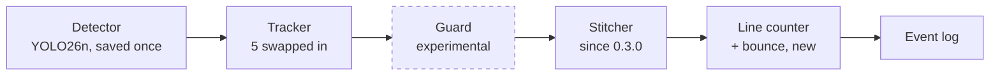
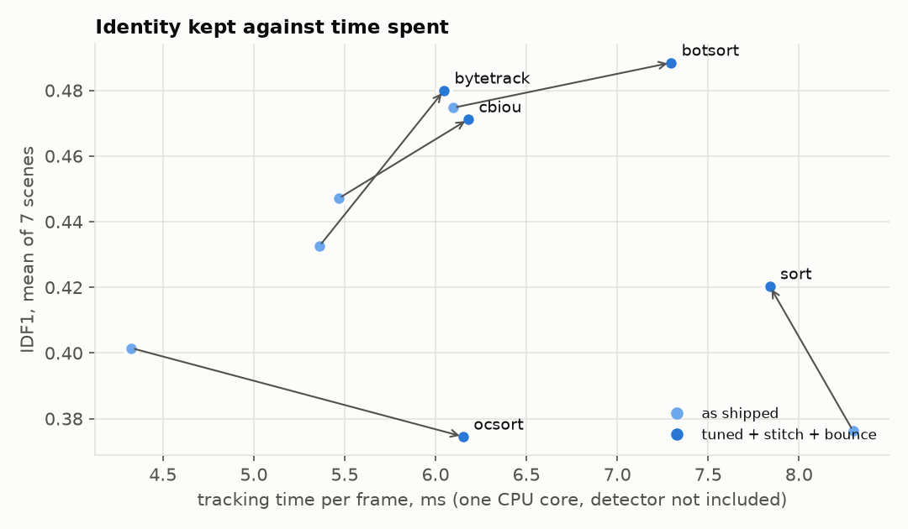
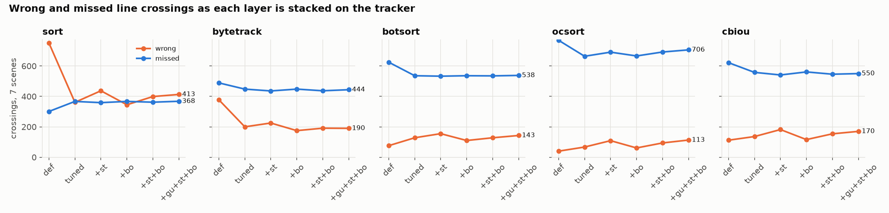
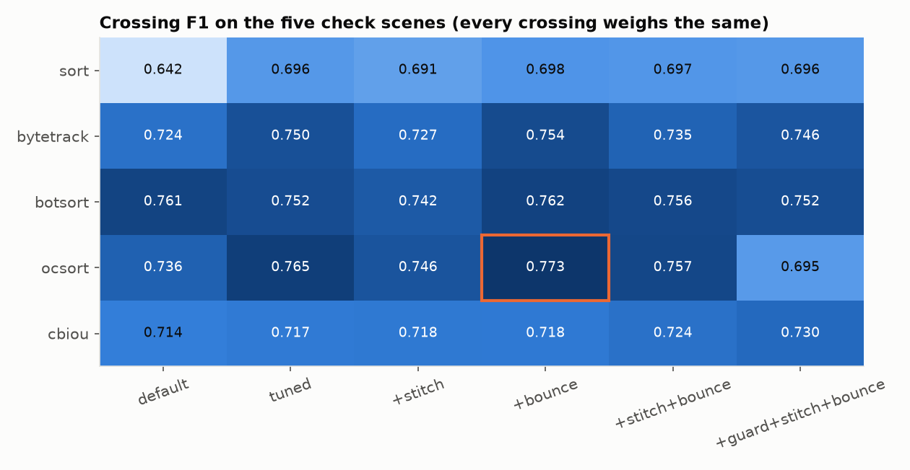
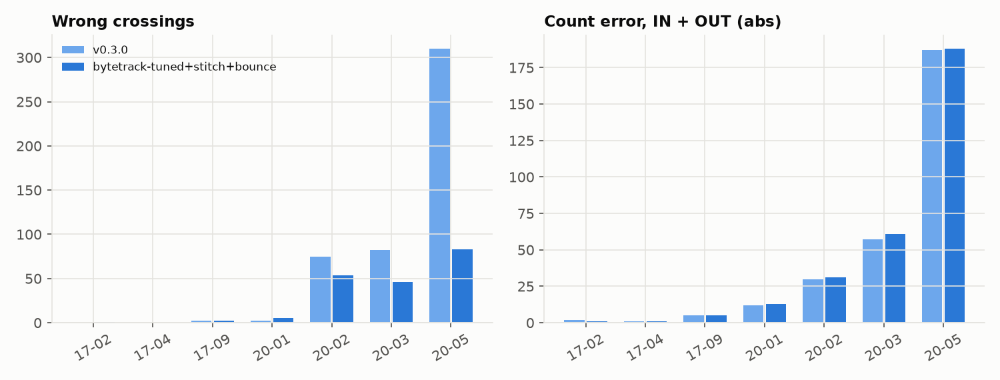

# Tracker study: crowds, ID swaps and wrong-way crossings

Phase 3, steps 1 and 2 ([PLAN.md](PLAN.md)). Which tracker should count people at a line in
a crowd, how should it be set, and what do our own layers on top of it add? Five trackers,
each as shipped and tuned, with our layers stacked one at a time: 31 setups on 7 hand
labelled scenes, 217 runs, every one saved with a video.

## In short

| v0.3.0 to the chosen setup | tune scenes (MOT20-03, 05) | check scenes (the other 5) |
| --- | --- | --- |
| wrong crossings (counted, but nobody crossed that way) | 392 to **129** (-67%) | 79 to **62** (-22%) |
| missed crossings (someone crossed, not counted) | 366 to 364 | 69 to 73 |
| crossing F1 | 0.633 to **0.727** | 0.721 to **0.735** |
| ID switches | 7,760 to **4,028** (-48%) | 1,857 to **1,426** (-23%) |
| IDF1 (mean per scene) | 42.1 to **45.9** | 47.1 to **48.8** |
| tracking time per frame (one CPU core) | 11.8 to 12.4 ms | 3.7 to 3.5 ms |

The chosen setup is ByteTrack with four settings changed, our stitcher at 1 s instead of
2 s, and `line_bounce`, a new rule of ours. It was picked on the two tune scenes, so the
gain there is what fitting can reach; the check scenes, never used to choose, are the fair
measure. There the drop in wrong crossings comes from one scene, MOT20-02 (75 to 54); the
other four go from 4 to 8. What became the default, and what stays a crowd setting, is in
[Decisions](#decisions).

- **Tuning the tracker is the biggest lever on the crowds.** ByteTrack with stricter box
  matching and a lower bar for new tracks halves its wrong crossings there (310 to 143)
  and cuts ID switches by 37%. On the check scenes the gain is smaller (68 to 57).
- **The bounce rule works on every tracker.** It removes 4 to 15% of the wrong crossings
  left after tuning, on all five trackers, loses at most 3 real crossings, and raises
  the F1 on the check scenes for all five.
- **Our stitcher trades wrong crossings for misses.** In crowds it adds wrong crossings on
  all five trackers (by 13 to 63%) and saves a few misses. On the two crowds that still
  nudges ByteTrack's F1 up, so the chosen setup has it; on the check scenes it lowers the
  F1 for four trackers out of five. It becomes a per scene setting.
- **A per frame swap detector does not work** (measured, kept in the study only): most
  swaps are slow drifts between overlapping people, not jumps.
- **A large share of the misses are tracking, not detection.** Of the 437 missed
  crossings, 156 had the person detected in at least half the frames around the
  crossing, yet no track on them, a track that starts or ends at the line, or an ID that
  changes there. Only 28 were never detected. No layer here more than barely reduces
  them, so they are the next tracking problem
  ([Misses](#where-the-misses-come-from)), alongside Phase 4's crowd trained detector.
- **The check scenes do not confirm one tracker for every scene.** ByteTrack is best on
  the crowds, but on the check scenes OC-SORT with bounce (0.773) and BoT-SORT as
  shipped (0.761) score higher than ByteTrack with bounce (0.754). Choosing the tracker
  per scene is what `pathsense tune` (step 4) is for.

## The pipeline being tested



Every run replays the same saved detections, so the only thing that changes is what
comes after the detector. Replays go through `Pipeline.track`, the code a live video uses.
The one difference is that a replay passes no images, so BoT-SORT cannot use its camera
motion compensation. It is switched off in every BoT-SORT run here (`enable_cmc: false`);
with fixed cameras there is no camera motion to correct.

## Setup

**Scenes.** Seven fixed camera sequences from MOT17 and MOT20, labelled by hand: every
person in every frame has a box and an ID. Each scene has a line and a zone placed for a
real use case (`configs/scenes/mot/`). The labels pass through the same line counter as
our tracks, so every true crossing is known.

| scene | what it shows | frames | people | true IN / OUT |
| --- | --- | --- | --- | --- |
| MOT17-02 | square, people walking past a tree | 600 | 74 | 1 / 10 |
| MOT17-04 | pedestrian street at night, from high up | 1,050 | 88 | 8 / 5 |
| MOT17-09 | shop entrance, close up | 525 | 27 | 1 / 10 |
| MOT20-01 | station concourse | 429 | 80 | 14 / 21 |
| MOT20-02 | station concourse, busier | 2,782 | 274 | 157 / 33 |
| MOT20-03 | crowd leaving a stadium at night | 2,405 | 724 | 4 / 376 |
| MOT20-05 | dense square at night | 3,315 | 1,200 | 46 / 594 |

MOT data is CC BY-NC-SA: evaluation only. No frame of it appears in these docs; the
charts here are drawn from numbers only.

**Tune and check.** Every setting was chosen on MOT20-03 and MOT20-05, the two crowds
with the wrong-way problem. The other five scenes were not looked at while choosing; they
show whether a choice holds or was fitted to two videos.

**Metrics.**
- *Crossings, one by one.* Each of our crossings is tied to the labelled person under
  its box. It is right only if that person crossed the same way within 2 s. A wrong
  crossing and a missed one do not cancel out, as they do in a total. A swap shows up
  twice: a wrong crossing on the person the ID moved to, and a missed one for the person
  who really crossed.
- *Is the scoring fair?* Every saved run was rescored (`scripts/tracker_study check`)
  with a stricter box overlap (0.5 instead of 0.3), a longer look after the crossing (1 s
  instead of 0.5) and a wider time window (3 s instead of 2). The F1 values move by up to
  0.03, but the trackers keep their order on all seven scenes, and on the check scenes
  OC-SORT and BoT-SORT stay ahead of ByteTrack. The full table is in
  `runs/tracker-study/report/matcher.md`; ByteTrack with bounce, for example, scores
  0.696 to 0.734 over all scenes and 0.734 to 0.758 on the check scenes.
- *Crossing F1*: every crossing weighs the same, so a false IN costs as much as a missed
  OUT. This is what settings were chosen by.
- *HOTA, MOTA, IDF1, ID switches*: the standard tracking measures, computed with
  TrackEval's rules (distractors such as static people neither right nor wrong).
- *Speed*: tracking time per frame on one CPU core. The detector is not included; it
  takes 38 to 57 ms per frame at `imgsz` 1920 on the GTX 1650, 3 to 16 times more.

**Sweep.** For each tracker, every combination of how long a lost track is kept (1, 2 or
4 s), how much boxes must overlap to match (0.1 to 0.4), and how confident a new track
must be (0.4 to 0.7): up to 48 settings. Then four ways to measure overlap (IoU, GIoU,
DIoU, buffered IoU) on the best one, then our layers' own settings: 532 replays.

## Step 1: where the wrong-way crossings come from

Before changing anything, each of the 29 INs on MOT20-03 (true: 4) was traced
against the labels: which person was the ID on before its previous crossing, and after
this one?

| cause | count |
| --- | --- |
| the tracker moved the ID from one person to another | 18 |
| the ID moved onto a box covering 2 to 4 people, or part of one | 4 to 5 |
| people who stepped up to the line and turned back (real, but not counted as crossings by the labels' margin) | 3 |
| a real IN | 1 |
| a box with nobody in it | 1 to 2 |

So 18 are swaps, and 4 or 5 more are the tracker following one box over a group: about 22
of 29 are the tracker. Neither the stitcher nor the hidden legs estimate is the cause: with
both off, v0.3.0 still counts 29 INs on MOT20-03, 28 of them wrong.

A swapped ID leaves a pattern in the events: OUT (person A), IN (the ID slides
back onto B behind them), OUT (B reaches the line). That pattern is what the bounce rule
looks for.

## Swapping the tracker



| tracker | idea | as shipped: wrong / missed | tuned: wrong / missed | tuned IDF1 |
| --- | --- | --- | --- | --- |
| SORT | one matching pass, the classic baseline | 751 / 301 | 361 / 367 | 39.7 |
| ByteTrack | a second pass for low confidence boxes | 378 / 489 | **200 / 448** | 47.8 |
| BoT-SORT | ByteTrack style, different box model | 76 / 625 | 128 / 536 | **49.2** |
| OC-SORT | corrects motion after occlusion | **40** / 769 | 67 / 664 | 40.1 |
| C-BIoU | matches on enlarged boxes | 112 / 622 | 136 / 558 | 46.8 |

The trackers sit on a line from "counts everything" to "counts only what it is sure of".
SORT counts the most real crossings and the most false ones. OC-SORT is the opposite: it
rarely counts a crossing that did not happen, but misses 769, because it drops tracks in
the crowd. Tuning moves every tracker towards the middle. ByteTrack tuned is the best
balance on the crowds; BoT-SORT keeps identities best (without camera motion
compensation, as above).

The tuned settings, chosen on the two crowds:

| tracker | keep lost | match overlap | new track confidence | overlap measure |
| --- | --- | --- | --- | --- |
| SORT | 1 s | 0.4 | 0.4 | GIoU |
| ByteTrack | 2 s | 0.4 | 0.4 | DIoU |
| BoT-SORT | 4 s | 0.1 | 0.4 | IoU |
| OC-SORT | 4 s | 0.2 | n/a | IoU |
| C-BIoU | 2 s | 0.2 | 0.4 | buffered (built in) |

Several of these sit at the edge of the grid, so the chosen ByteTrack setup was run one
step further: a confidence of 0.3 changed nothing, an overlap of 0.5 lost 26 real
crossings, and a bounce beyond 12 s removed one more wrong crossing. The choices are at
the optimum or on a flat plateau, not cut off by the grid.

## Stacking our layers





The matrix is the check: these five scenes were never used to choose anything.

### Bounce (new): `analytics.line_bounce`

A crossing that reverses the ID's last one is held for a few seconds. If the ID crosses
back the original way in that time, the held crossing was an ID moving between people:
it is dropped, and the crossings on either side count. Someone who really turns round
at the line crosses back once and stays, so their crossing is only late, not lost. A
person's first crossing is never held.

| | wrong IN (7 scenes) | wrong OUT (7 scenes) | missed IN (7 scenes) | missed OUT (7 scenes) | F1, check scenes |
| --- | --- | --- | --- | --- | --- |
| SORT tuned | 151 | 210 | 67 | 300 | 0.696 |
| + bounce | 139 | 206 | 67 | 300 | 0.698 |
| ByteTrack tuned | 79 | 121 | 74 | 374 | 0.750 |
| + bounce | **61** | **114** | 74 | 374 | **0.754** |
| BoT-SORT tuned | 58 | 70 | 73 | 463 | 0.752 |
| + bounce | 49 | 61 | 73 | 463 | 0.762 |
| OC-SORT tuned | 32 | 35 | 89 | 575 | 0.765 |
| + bounce | 30 | 31 | 91 | 575 | 0.773 |
| C-BIoU tuned | 66 | 70 | 82 | 476 | 0.717 |
| + bounce | 52 | 64 | 85 | 476 | 0.718 |

On every tracker it removes wrong crossings in both directions, misses at most 3 more
real ones, and raises the F1 on the check scenes. It costs nothing measurable in time. It
does not catch a swap whose second person never reaches the line, which is why ByteTrack
still makes 61 wrong INs. On MOT20-05 alone, wrong crossings fell from 310 (v0.3.0) to 83.

The rule has two costs:
- **Delay.** A reversing crossing reaches the event log up to 12 s late (12.5 s with the
  0.5 s confirmation), dated when it happened. The live IN and OUT totals lag by the same
  amount for those few crossings.
- **Dithering.** Someone who crosses, crosses back and crosses again within 12 s looks
  exactly like a swap, so their crossing back is dropped: IN, OUT, IN counts as IN, IN. On
  these scenes the rule removed far more swaps than it cost, but a doorway where people
  often step out and back in would see it.

### Stitcher (since 0.3.0): trades wrong crossings for misses

The stitcher gives a person the tracker lost their old ID back when a new box appears
where they were heading. On the sample clips it fixed split tracks. In crowds it adds
wrong crossings on all five trackers: ByteTrack 200 to 225, SORT 361 to 437, OC-SORT 67 to
109. When dozens of people vanish and appear every second, the nearest vanished person is
often the wrong one. In return it saves a few misses (ByteTrack 448 to 436).

Which side wins depends on the scene. On the two tune crowds, a 1 s stitch raises
ByteTrack's F1 slightly (0.711 to 0.716 alone, 0.720 to 0.727 with bounce), so the sweep
chose it, and the crowd scene files use it. On the check scenes it lowers the F1 for four
trackers out of five (ByteTrack with bounce: 0.754 to 0.735, with 8 more wrong crossings
and 3 more missed). So it is a per scene setting: on for sparse scenes with pillars and
doors, where it mends split tracks; short or off in crowds, as `pathsense tune` decides.

### Guard (experimental, not shipped): a per frame swap detector

The first idea was to catch a swap the moment it happens: a box whose feet land far from
where the person was heading, or whose height jumps, gets a new ID, and the stitcher
gives each box back the right person. Measured against the labels on MOT20-03, swaps do
not look like that. Over 229,000 frame steps of normal tracking and 6,700 steps where the
labelled person under a track changes, the median jump is 0.02 box heights for normal
steps and 0.04 for swaps: the ID drifts across while two boxes overlap. The best
threshold caught 11% of swaps and raised 793 false alarms. In the full study it adds wrong
crossings on four trackers out of five and 0.5 to 3.4 ms per frame. It is kept in
`scripts/tracker_study/guard.py` as a recorded negative result.

## Per scene: v0.3.0 against the chosen setup



| scene | setup | IN ours / true | OUT ours / true | wrong | missed | IDF1 |
| --- | --- | --- | --- | --- | --- | --- |
| MOT17-02 | v0.3.0 | 0 / 1 | 9 / 10 | 0 | 2 | 39.3 |
| | chosen | 0 / 1 | 10 / 10 | 1 | 2 | 38.4 |
| MOT17-04 | v0.3.0 | 8 / 8 | 4 / 5 | 0 | 1 | 55.5 |
| | chosen | 8 / 8 | 4 / 5 | 0 | 1 | 59.7 |
| MOT17-09 | v0.3.0 | 3 / 1 | 7 / 10 | 2 | 3 | 49.8 |
| | chosen | 3 / 1 | 7 / 10 | 2 | 3 | 51.9 |
| MOT20-01 | v0.3.0 | 11 / 14 | 12 / 21 | 2 | 14 | 47.4 |
| | chosen | 11 / 14 | 11 / 21 | 5 | 18 | 50.2 |
| MOT20-02 | v0.3.0 | 155 / 157 | 61 / 33 | 75 | 49 | 43.4 |
| | chosen | 144 / 157 | 51 / 33 | 54 | 49 | 44.0 |
| MOT20-03 | v0.3.0 | 29 / 4 | 344 / 376 | 82 | 89 | 52.1 |
| | chosen | 11 / 4 | 322 / 376 | 46 | 93 | 55.1 |
| MOT20-05 | v0.3.0 | 156 / 46 | 517 / 594 | 310 | 277 | 32.1 |
| | chosen | 41 / 46 | 411 / 594 | 83 | 271 | 36.6 |

The total count error per scene (right chart) barely moves (MOT20-05: 187 to 188;
MOT20-03: 57 to 61) while wrong crossings fall sharply (MOT20-05: 310 to 83; MOT20-03:
82 to 46), but which way it errs changes.
On MOT20-05 the IN error falls from 110 to 5 and the OUT error grows from 77 to 183. In
v0.3.0, false crossings were filling the gap left by missed ones: MOT20-05's OUT total of
517 looked closer to the truth (594) than the new 411, but 310 of v0.3.0's crossings were
wrong. That is why crossings are scored one by one here, and why totals alone would have
led to the wrong choice.

Two check scenes got worse on crossings: MOT20-01 (wrong 2 to 5, missed 14 to 18, out of
35 true crossings, although its IDF1 rose from 47.4 to 50.2) and MOT17-02 (1 more wrong,
IDF1 39.3 to 38.4).

## Where the misses come from

The misses hardly move with any layer (436 to 448 across the tuned ByteTrack setups, 435
for v0.3.0), which first looked like a detection limit. For each of the chosen setup's 437
missed crossings, `scripts/tracker_study check` asks two questions of the labelled person
who crossed. Was a saved detection on them (a box at IoU 0.5 or more) in the frames within
0.5 s of the crossing? And which of our IDs was on them in the second before and the second
after?

| what our tracks did | detected in at least half the frames | detected in some frames | detected never | all |
| --- | --- | --- | --- | --- |
| no track on them | 64 | 44 | 23 | 131 |
| one ID before and after, no matching crossing | 114 | 11 | 0 | 125 |
| track starts or ends at the line | 46 | 43 | 4 | 93 |
| ID changes at the line | 46 | 8 | 0 | 54 |
| swap: our ID crossed, scored on someone else | 23 | 10 | 1 | 34 |
| all | 293 | 116 | 28 | 437 |

Reading it:
- **Tracking, clearly:** 156 misses where the person was detected in at least half the
  frames, but the tracker had no track on them, started or ended one at the line, or
  changed the ID there. A further 34 are swaps, already counted once as wrong crossings.
- **Detection, clearly:** 28 never detected. The 116 detected only in some frames are
  both: a steadier detector and a tracker that holds on through gaps would each help.
- **Unclear:** 125 had one ID on them throughout, yet no crossing matched. Their ID may
  have crossed more than 2 s away, or been scored on someone else during the look after
  the crossing, so part of this group may be the scoring being strict.

So a better detector (Phase 4) will help, but at least a third of the misses are the
tracker, and they are the next tracking problem. The labels include people hidden at the
moment of crossing and people labelled as standing still, so a few true crossings are
unreachable for any setup.

## A correction made during the study

The first sweep chose settings by the F1 of each direction averaged, so the rare
direction (about 50 true INs on the crowds) weighed as much as the common one (about
970 OUTs). It chose BoT-SORT, which cut wrong INs to 19 by missing about 100 more real
OUTs than ByteTrack. Removing false crossings by also losing real ones is not an
improvement, so the objective was changed to plain crossing F1, where every crossing
weighs the same, and the sweep was run again. The first sweep's results are kept
(`runs/tracker-study/sweep-v1-macro/`).

## Decisions

What changes in the product, and why each choice is no wider than the evidence:

1. **`analytics.line_bounce` is on by default, at 12 s.** It helped on every tracker and
   on the check scenes. On the four public sample clips it changes one count: subway
   boardings 7 to 6. people-walking keeps its hand count (11 IN, 7 OUT); grocery and
   market are unchanged. Its cost is that a crossing back is logged up to 12 s late (with
   its real time).
2. **The tracker defaults stay as in 0.3.0.** The tuned ByteTrack settings were also run
   on the four sample clips. people-walking and market keep their counts, but the grocery
   shopper is counted twice (2 IN, 3 aisle visits, where 1 is right). One setting does it:
   the 0.4 overlap. The shopper walks towards a 4K camera, his box grows fast from frame
   to frame, its overlap with the last one sometimes falls below 0.4, and the track breaks.
   In a crowd that same strictness is what stops an ID sliding onto a neighbour.
3. **The two crowds get the crowd settings in their scene files** (MOT20-03 and 05): the
   tuned ByteTrack and a 1 s stitch. Only the scenes the settings were chosen on; the
   others get theirs from `pathsense tune`.
4. **The stitcher stays on (2 s) by default.** On the subway clip, turning it off raised
   the people count from 78 to 104 IDs and platform enters from 78 to 91: in sparse scenes
   it still mends split tracks. In crowds it adds wrong crossings (above), so crowd scenes
   set it lower.
5. **ByteTrack stays the default tracker.** It is the best on the two crowds and over
   all seven scenes, and as fast as any. The check scenes do not single it out: OC-SORT
   with bounce (0.773) and BoT-SORT as shipped (0.761) score higher there, and BoT-SORT
   keeps identities slightly better (IDF1 49.2 against 47.8). So the default does not
   change, and `pathsense tune` will choose among all five per scene.

The sample clip runs (sample clips are public, so these are reproducible by anyone):

| clip | v0.3.0 | + bounce | tuned ByteTrack + bounce | expected |
| --- | --- | --- | --- | --- |
| people-walking | 11 IN, 7 OUT | 11 IN, 7 OUT | 11 IN, 7 OUT | 11 IN, 7 OUT (hand count) |
| grocery-store | 1 IN, 1 visit | 1 IN, 1 visit | 2 IN, 3 visits | 1 IN, 1 visit |
| subway | 7 boarded, 10 off | 6 boarded, 10 off | 7 boarded, 11 off | not hand counted |
| market-square | 1 IN, 16 OUT | 1 IN, 16 OUT | 1 IN, 17 OUT | not hand counted |

## Limits

- One detector (YOLO26n at `imgsz` 1920 for most scenes, saved once). A better detector
  will move every number; the study reruns in about an hour.
- Two tune scenes. Both are night crowds walking mostly one way. The check scenes show
  the layers hold up, but the tracker choice does not, and two scenes got slightly
  worse (MOT20-01, MOT17-02).
- The best tracker depends on the scene: on the check scenes OC-SORT with bounce scores
  higher (0.773) than ByteTrack with bounce (0.754), because they are sparser and reward
  OC-SORT's caution. This is what `pathsense tune` (Phase 3, step 4) is for: choosing the
  tracker and its settings per scene, from a short labelled clip.
- No appearance features (ReID) were tried. They might mend the misses where an ID
  changes at the line, but would have to earn their cost in a browser.
- The labels' crossings include people hidden at that moment (any visibility) and people
  labelled as standing still, so a few true crossings cannot be seen by any detector.

## Reproduce

```bash
uv run python scripts/mot_counts.py prepare     # MOT zips in data/mot/ -> videos and labels
uv run python scripts/tracker_study cache       # detector once per scene (GPU, about 10 min)
uv run python scripts/tracker_study all         # sweep, run, render, report, check (CPU, 2 to 3 h)
uv run python scripts/tracker_study check       # where the misses come from; matcher rescoring (2 min)
```

The study is defined in `configs/study/trackers.yaml`. Output, not in git:

```
runs/tracker-study/
  sweep/sweep.csv, best.json     every setting tried on the tune scenes, and the choice
  runs/<setup>/<scene>/          tracks.txt (MOT format), events.jsonl, crossings.json,
                                 metrics.json, video.mp4 (crossings marked right, wrong,
                                 missed)
  results.csv                    one row per setup and scene (217)
  report/                        these charts and tables; misses.md and matcher.md
```
